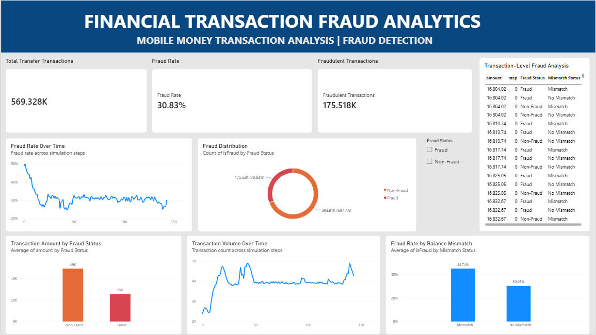

# Financial Transaction Fraud Analytics & Risk Investigation

An end-to-end analytics case study investigating fraud-labelled patterns in **1.72 million synthetic mobile-money transactions**. The project combines Python-based EDA, statistical testing, account-behaviour feature engineering, chronological model evaluation and an interactive Power BI dashboard.

> **Important:** This is an exploratory case study using synthetic data. The model is not production-ready and should not be represented as an effective real-world fraud detector.

## Business questions
- Which transaction types contain fraud-labelled records in this dataset?
- How do transaction amounts and fraud-label rates vary?
- Are sender or recipient balance mismatches associated with fraud labels?
- Do account-level historical activity patterns differ?
- How well does a model generalise to later simulation steps?

## Dataset
The source dataset contains **1,720,181 transactions and 10 columns**. The analysis focuses on the **569,328 TRANSFER transactions**.

| Measure | Result |
|---|---:|
| All transactions | 1,720,181 |
| Transfer transactions | 569,328 |
| Fraud-labelled transfers | 175,518 |
| Fraud-label rate among transfers | 30.83% |
| Fraud-label rate across all transactions | 10.20% |

All fraud-labelled records in this supplied dataset are TRANSFER transactions. This is a property of this synthetic dataset, not a general rule about financial fraud.

## Key analytical findings
- The dataset contains no missing values or exact duplicate rows in the initial quality checks.
- Fraud labels are concentrated entirely in TRANSFER records.
- Sender and recipient balance-mismatch indicators show statistically significant associations with fraud labels, but their Cramér's V values are small (approximately 0.038 and 0.041). Statistical significance does not imply strong predictive power or causation.
- The fraud-label rate is 44.74% for records with a balance mismatch versus 30.05% without one in the dashboard's mismatch grouping. Treat this as a dataset-specific association.
- Historical sender and recipient activity features are engineered from earlier simulation steps.

## Modelling and evaluation
A Random Forest classifier is evaluated using chronological train, validation and held-out test partitions.

| Test metric | Result |
|---|---:|
| Accuracy | 64% |
| Precision (fraud class) | 33% |
| Recall (fraud class) | 22% |
| F1-score (fraud class) | 0.26 |
| ROC-AUC | 0.5471 |
| PR-AUC | 0.3295 |

The held-out majority-class accuracy baseline is approximately **70.52%**, so the model's accuracy is below that baseline. Its recall and ranking performance are also weak. These results are reported transparently rather than presented as a successful fraud detector.

### Feature availability and leakage caution
Balance-difference and mismatch features are derived using post-transaction balance values. These can support retrospective fraud investigation, but may not be available at transaction authorisation time. A production-oriented model would need a strictly point-in-time feature set and a fresh chronological evaluation. Historical account features in this analysis are built from prior simulation steps.

## Power BI dashboard



Dashboard components:
- Transaction volume and fraud-label KPIs
- Fraud-label distribution
- Fraud rate over simulation steps
- Average transaction amount by fraud label
- Transaction volume over time
- Fraud rate by balance-mismatch status
- Transaction sample table and fraud-status slicer

## Repository structure
```text
financial-transaction-fraud-detection/
├── README.md
├── requirements.txt
├── data/
│   └── README.md
├── notebooks/
│   └── Financial_Transaction_Fraud_Analysis_Reviewed.ipynb
└── dashboard/
    ├── Financial_Transaction_Fraud_Analytics_Dashboard.pbix
    └── financial_transaction_fraud_dashboard_final.png
```

## Run the project
1. Clone or download this repository.
2. Create a `data/` folder in the repository root.
3. Place the source file at `data/synthetic_mobile_money_transaction_dataset.csv`. The dataset itself is not included in this repository.
4. Install dependencies:
   ```bash
   pip install -r requirements.txt
   ```
5. Open and run `notebooks/Financial_Transaction_Fraud_Analysis_Reviewed.ipynb` from the repository root.

## Tools
Python · Pandas · NumPy · SciPy · Scikit-learn · Imbalanced-learn · Matplotlib · Seaborn · Jupyter Notebook · Power BI

## Project files
- [Analysis notebook](notebooks/Financial_Transaction_Fraud_Analysis_Reviewed.ipynb)
- [Power BI dashboard](dashboard/Financial_Transaction_Fraud_Analytics_Dashboard.pbix)
- [Dashboard preview](dashboard/financial_transaction_fraud_dashboard_final.png)

## Future improvements
- Rebuild the model using only features available at authorisation time.
- Compare against simple and cost-sensitive baselines.
- Evaluate precision-recall trade-offs using an explicit false-positive/false-negative cost framework.
- Test on independent, representative data if available.
- Add SQL-based analysis as a complementary analytics layer.

---
**Project areas:** Data Analytics · Statistical Analysis · Feature Engineering · Machine Learning Evaluation · Power BI
